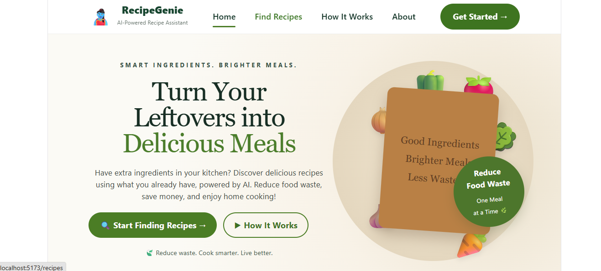
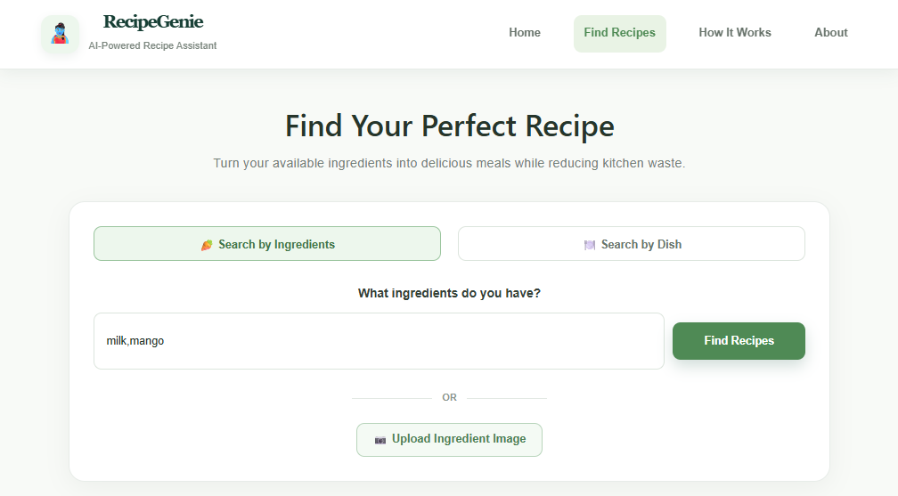
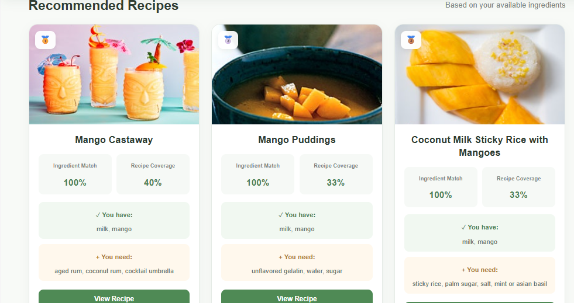
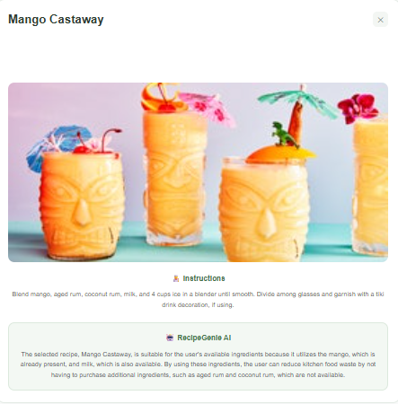
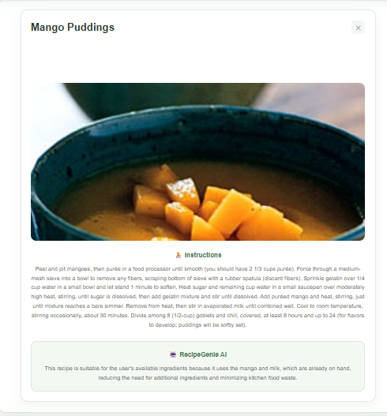
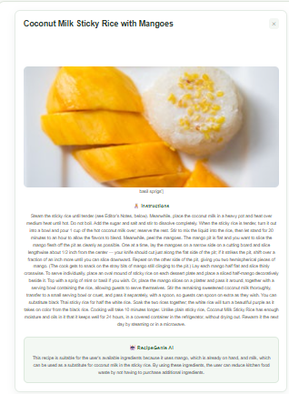

# 🍲 RecipeGenie — AI-Powered Recipe Assistant

RecipeGenie is an AI-powered recipe recommendation system that helps users discover recipes from available ingredients and ingredient images, with the goal of reducing kitchen food waste.

## Features

- 🥕 Search recipes using available ingredients
- 🍽️ Search recipes by dish name
- 📷 Upload ingredient images for visual understanding
- 🤖 AI integration using locally hosted models
- 🔎 Semantic retrieval using embeddings and FAISS
- 📊 Ingredient Match and Recipe Coverage information
- 🧾 Displays ingredients you have and ingredients you need
## Project Screenshots

### 🏠 Home Page


### 🥗 Ingredient Input


### 🍲 Recipe Recommendations


### 🍽️ Recommended Recipes





## Tech Stack

### Frontend
- React
- Vite
- JavaScript
- HTML and CSS

### Backend
- Python
- FastAPI

### AI and Retrieval
- Ollama
- Llama 3.2 — language model
- Qwen2.5-VL 3B — image understanding
- Nomic Embed Text — text embeddings
- FAISS — vector similarity search

## Project Structure

```text
AI-Kitchen-Waste-Recipe-Assistant/
├── backend/
├── frontend-react/
├── dataset/
├── faiss_index/
├── .gitignore
└── README.md
```

## Prerequisites

- Python
- Node.js and npm
- Ollama
- Git

## Getting Started

### 1. Clone the repository

```bash
git clone https://github.com/Cibi-31/RecipeGenie.git
cd RecipeGenie
```

### 2. Set up the Python environment

```bash
python -m venv .venv
```

Activate it on Windows PowerShell:

```powershell
.\.venv\Scripts\Activate.ps1
```

Install the Python packages required by the backend. Use the project's dependency file if available, or install the packages listed in the backend imports.

### 3. Prepare Ollama models

Make sure Ollama is installed and running. Pull the models used by the project:

```bash
ollama pull llama3.2
ollama pull qwen2.5vl:3b
ollama pull nomic-embed-text
```

### 4. Start the FastAPI backend

From the project root, run:

```bash
python -m uvicorn backend.main:app --reload --port 8001
```

If your backend uses a different port or startup configuration, use the settings configured in your project.

### 5. Start the React frontend

Open another terminal:

```bash
cd frontend-react
npm install
npm run dev
```

Open the local URL printed by Vite in your terminal.

## Dataset and Vector Index

RecipeGenie uses a recipe dataset and a FAISS vector index for retrieval. Ensure these files are available before running the application. Follow the dataset's original license and usage terms.

## Security

- Never upload `.env` files, API keys, or passwords.
- Keep local virtual environments and `node_modules` out of version control.
- Do not commit private credentials or personal data.

## Project Objective

To help users make better use of available ingredients, discover suitable recipes, and reduce avoidable kitchen food waste.

##  Author

**Cibiksha V**

GitHub: https://github.com/Cibi-31

---

Built with AI to help reduce kitchen waste and make cooking smarter.
